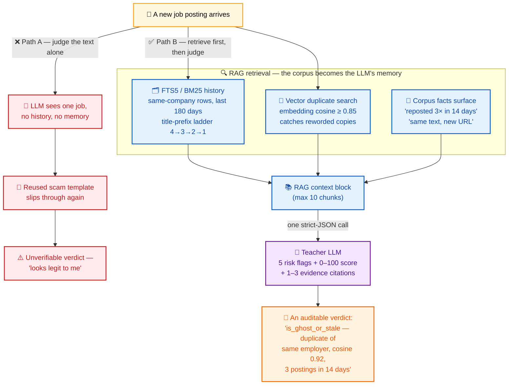

# How I built an AI that detects scam & fake jobs — the full design

> A public build log + design doc for **UK AI Job Hunter**: a self-improving
> job-search platform whose AI learns to spot scam, fake, and ghost job
> postings from real traffic. This repo shares **how it was designed, what
> it cost, how long it took, and the lessons learned** — no source
> code, data, or credentials included.

**Live product:** [jobs.ai-daily.uk](https://jobs.ai-daily.uk)

## The story in 60 seconds

I wanted a job board that didn't just *list* jobs but **judged** them —
because the biggest time-killer for job seekers isn't finding listings,
it's wading into scam, fake, and ghost postings. So I built a platform
that collects ~2,000–3,000 UK postings daily from multiple sources
(commercial job-board APIs, public ATS feeds, and web scraping — vendors
deliberately unnamed), and runs every listing through a **layered
scam-detection system** ending in a retrieval-augmented (RAG) trust scorer
that outputs 5 risk flags and a 0–100 score with cited evidence.

Building the detector was the easy-sounding part. The hard lessons were
operational: an inference endpoint that 400'd on every request, a training
set that silently stopped growing, token budgets that die if you call a
large model on every row. The fixes — local batch inference, a tiered
teacher cascade, append-only shards — are documented here in full.

## What it cost & how long it took (the honest ledger)

| Item | Cost | Time |
|---|---|---|
| Platform subscription (model hosting + Spaces) | ~$9/month | ongoing |
| Tag-classifier training (local CPU, 67M-param model) | **$0** | ~1 day |
| Scam/ghost/spam rule screening | **$0** | built into the pipeline |
| RAG trust scorer (retrieval + teacher prompts) | **$0** to run the retrieval | ~3–5 days to build |
| Teacher verification pilot (100 jobs) | **~$0.01** | 1 day |
| Full low-confidence re-label (10–20% of ~470k rows) | **~$2** | 1–2 days |
| Inference endpoint (avoided — replaced by local batch) | $0 (saved ~$0.10–0.30/h) | — |
| **Total build: ~3 months solo, part-time, ~1,600 commits** | **≈ $30 all-in** | breakdown below |

The trick that made this cheap: **never put a large-model call on the hot
path.** A small local model labels everything; a frontier-class teacher
(served through an OpenAI-compatible gateway, vendor unnamed) verifies only
the ~10–20% the small model was unsure about. Same quality signal, ~90%
less spend.

## Why RAG? (the diagram)

A language model judging a job by its text alone has **no memory** — the
same scam can fool it every time, and every verdict is an unauditable guess.
Retrieval gives the teacher a memory: what the corpus already knows about
that company, that listing, and its duplicates — turned into evidence the
verdict must cite.

**Three reasons the retrieval layer earns its place:**

1. **Memory** — a scam pattern seen once is retrievable forever; the corpus
   remembers what no prompt can.
2. **Evidence** — every flag must cite a retrieved fact, so a verdict can be
   audited instead of trusted.
3. **Cost control** — retrieval is SQLite + a local embedding ($0); the LLM
   call only *summarizes evidence the cheap layers already found*.

Full deep-dive: [`docs/scam-detection.md`](docs/scam-detection.md)

## Start here

| Read | If you want to know… |
|---|---|
| [`docs/scam-detection.md`](docs/scam-detection.md) | ⭐ **How the scam/fake-job detection actually works** — 4 layers, RAG retrieval design, strict-JSON verdicts |
| [`docs/teacher-student-loop.md`](docs/teacher-student-loop.md) | How the AI keeps getting better for ~$2.50 — the tiered teacher→student cascade |
| [`models/model-card-c1-jobtag.md`](models/model-card-c1-jobtag.md) | The tag classifier: F1 0.888 vs 0.575 baseline, 276 labels |
| [`models/model-card-trust-scorer.md`](models/model-card-trust-scorer.md) | The trust scorer: 5 flags, 0–100 score, evidence citations |
| [`docs/01-system-diagram.md`](docs/01-system-diagram.md) · [`02-data-flow.md`](docs/02-data-flow.md) · [`03-solution-architecture.md`](docs/03-solution-architecture.md) | The full system, layer by layer |
| [`docs/roadmap.md`](docs/roadmap.md) | What's shipped, what's next |

## 📊 Live jobs-data status (auto-refreshed daily)

<!-- LIVE-STATUS:START -->
| Jobs data | Value |
|---|---|
| 🗄 Jobs in the full database | **11,836** (UK-deduplicated) |
| 🆕 New jobs collected (latest day) | **248** |
| 🏷 Sectors tracked | 9 |
| 🕒 Data last refreshed | 2026-11-26 |
| ♻️ Collection pipeline | healthy — last batch 2.3 h ago |

| 🧠 AI training corpus | 128,627 gated rows · 12.9× the 10k minimum |
| 🛡 Scam screening | every listing passes rule + duplicate screening; RAG trust scoring live, labels accumulating toward student distillation |

**UK job market — live by sector**

| Sector | Jobs | 3-day | 7-day | Median £ | Top employers |
|---|---:|---:|---:|---:|---|
| Tech & IT | 30 | ▲ +22 (+275%) | ▼ -76 (-72%) | £55,300 | Catapult Sports, Avanade, Innovative Technology Ltd |
| Finance & Accounting | 15 | ▲ +8 (+114%) | ▼ -43 (-74%) | — | Jobgether, Marshmallow, Constructor |
| Sales & Marketing | 13 | ▲ +7 (+117%) | ▼ -11 (-46%) | — | Checkout.com, New Look, University of Edinburgh |
| Healthcare | 2 | ▲ +2 (+200%) | ▼ -4 (-67%) | £252,356 | Microsoft, Montu Uk |
| Warehouse & Logistics | 1 | ▲ +1 (+100%) | ▼ -8 (-89%) | — | AstraZeneca |
| Admin & HR | 0 | ＝ +0 (+0%) | ▼ -4 (-100%) | — | — |
| Industrial & Manufacturing | 0 | ＝ +0 (+0%) | ▼ -5 (-100%) | — | — |
| Retail & Customer Service | 0 | ＝ +0 (+0%) | ▼ -3 (-100%) | — | — |
| Other | 187 | ▲ +139 (+290%) | ▼ -7 (-4%) | £46,024 | Elsevier, BAE Systems, Checkout.com |
| **All sectors** | **248** | — | — | — | — |
| *Snapshot* | *2026-11-26 17:39 UTC — auto-updates daily ~07:00 UTC* |
<!-- LIVE-STATUS:END -->

> Job counts come from the production catalog API of
> [jobs.ai-daily.uk](https://jobs.ai-daily.uk), fetched by a scheduled GitHub
> Action in this repo (no credentials). Training-corpus figures update with
> each compaction milestone.

## Related

- Implementation repo: `uklukie/uk-ai-job-hunter-dev` (private)

## License

Documentation and diagrams: [CC BY 4.0](LICENSE) — share and adapt with
attribution. No source code, data, or credentials are included in this repo.

