# 1 — System Diagram (components as they exist today)

Rendered by GitHub natively. Status markers: **LIVE** components run in production; dashed boxes are offline/unused right now.

```mermaid
graph TB
    subgraph USERS["Users"]
        U1["Job seeker<br/>browser / mobile"]
        U2["Operator (owner)"]
    end

    subgraph SPACE["HuggingFace PRO Space (nginx + uvicorn, port 7860)"]
        direction TB
        subgraph FE["Frontend — React SPA (Vite build)"]
            L1["Landing page<br/>JobTypeCatalogStrip<br/>(sector table, 3d/7d deltas)"]
            L2["My CV Match<br/>resume upload + filters<br/>CvSearchSSE (live progress)"]
            L3["Results view<br/>JobResultTable<br/>match_score + breakdown"]
            L4["Source tabs<br/>Adzuna / JobSpy views"]
        end

        subgraph BE["Backend — FastAPI (api/v1)"]
            R1["/pipeline/finalize<br/>(controller)"]
            R2["/pipeline/cvsearch/stream<br/>(cvsearch + SSE)"]
            R3["/trust-score<br/>(RAG scorer)"]
            R4["/job-catalog<br/>(local -> HF fallback)"]
            R5["/saved-links<br/>(7-day share links)"]
            R6["auth / profile / cover-letter<br/>dataset / health / system"]
        end

        subgraph SVC["Core services"]
            S1["dedup<br/>exact + vector 0.88<br/>is_uk_location<br/>ghost / spam score"]
            S2["index_store<br/>SQLite FTS5 + embeddings<br/>date-partitioned shards"]
            S3["semantic_match<br/>all-mpnet cosine"]
            S4["matching<br/>HF pool / Claude / local"]
            S5["training_data<br/>schema v2.0 + PII scrub"]
            S6["job_catalog<br/>12-sector bucketing"]
            S7["trust_score<br/>RAG teacher pipeline"]
            S8["dataset_sync<br/>hydrate_from_hf"]
        end
    end

    subgraph HF["HuggingFace (PRO)"]
        D1[("pro-data<br/>jobs repo (private)<br/>*_latest.jsonl<br/>deduped_jobs.json")]
        D2[("dev-autotrain<br/>training repo (private)<br/>69 shards + Parquet splits<br/>saved-links/*")]
        D3[("autotrain-models<br/>model repo (private)<br/>c1-jobtag-distilbert-v1")]
    end

    subgraph EXT["External sources / APIs"]
        E1["Adzuna API"]
        E2["Reed API"]
        E3["JobSpy scraper<br/>(Indeed etc.)"]
        E4["Greenhouse / Lever<br/>Ashby / Workable / Arbeitnow"]
        E5["Claude / Gemini<br/>(profile, cover letter)"]
    end

    subgraph GHA["GitHub Actions"]
        A1["ci.yml<br/>checks + Space deploy"]
        A2["sync-jobs-oct26.yml<br/>daily 06:00 UTC"]
        A3["compact-dataset.yml<br/>nightly (08:00 UTC, green)"]
    end

    U1 -->|"HTTPS"| FE
    U2 -->|"Actions page"| GHA

    L2 -->|"resume upload"| R2
    L1 -->|"fetch catalog JSON"| R4
    L3 --> R5
    R5 --> S8

    R1 --> S1
    R1 --> S6
    R1 --> S5
    R2 --> S2
    R2 --> S3
    R3 --> S2
    R3 --> S4
    R4 --> S6

    A2 -->|"collect + finalize"| R1
    A3 -->|"/dataset/compact"| R1
    A1 -->|"deploy code"| SPACE

    R1 -->|"*_latest.jsonl<br/>deduped_jobs.json"| D1
    S5 -->|"data/shards/<date>/"| D2
    R5 -->|"saved-links/* (fallback)"| D2
    S8 -->|"hydrate at startup"| D1

    E1 -->|"daily collect"| A2
    E2 -->|"daily collect"| A2
    E3 -->|"daily collect"| A2
    E4 -->|"daily collect"| A2
    E5 -.->|"profile / cover letter"| R6
```

## Component inventory

| Layer | Components | Source of truth |
|---|---|---|
| Frontend | Landing (+catalog strip), CV Match, Results, saved links | `app/src/` |
| Routers | 13 FastAPI routers under `/api/v1` | `backend/app/routers/` |
| Services | dedup, index_store, semantic_match, matching, training_data, job_catalog, trust_score, dataset_sync, exports, cache, saved_job_links | `backend/app/services/` |
| Storage | 3 private HF repos (jobs / training / models) + ephemeral Space disk | `backend/app/core/config.py` |
| Automation | 12 GitHub Actions workflows (1 legacy removed 2026-11-17) | `.github/workflows/` |
