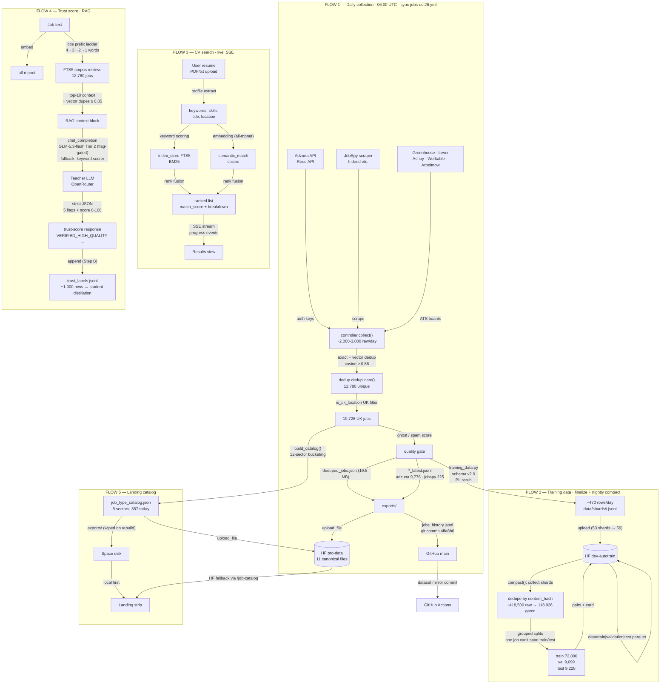

# 2 — Data Flow (how every byte moves through the system)

Five flows, numbered in execution order. Numbers show the measured volumes from the 2026-11-17 stocktake.

## Key numbers (2026-11-22 refresh)

| Stage | Volume |
|---|---|
| Raw rows written to shards | ~468,900 |
| Pass quality gate | 193,635 (2026-11-19 compact; negative_share 0.238, 0 label conflicts) |
| Published train split | 128,627 rows (`data/train.parquet`) |
| Daily shards on storage | 69 (uploading daily) |
| Live deduped job pool | 12,780 → 10,728 UK |
| Trust labels logged (Step B) | accumulating toward ~1,000 |

*(Numbers from the 2026-11-17 stocktake appear inline in the diagram; this table is the current measurement.)*
