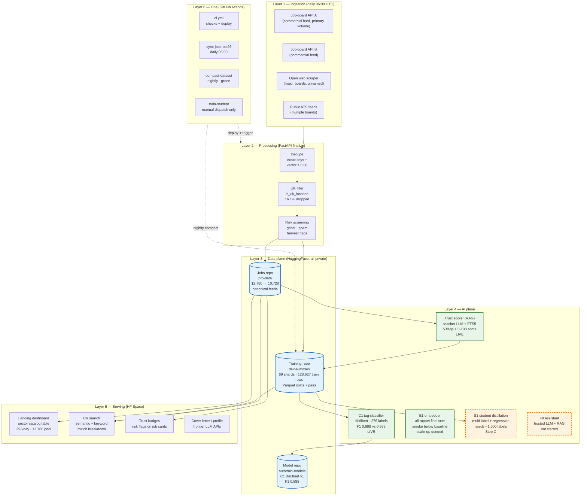

# 3 — Full Solution Architecture (current + planned evolution)

Solid borders = built and live. Dashed borders = designed, not yet built (student model, RAG trust-score UI wiring, per-sector rebalance).



## Read this diagram as three phases

| Phase | What exists | What is dashed |
|---|---|---|
| **Now** | Full ingestion → dedupe → UK filter → data plane → serving. C1 classifier trained and promoted. Trust scorer live. | — |
| **Next** (Step B/C) | Label accumulation in `trust_labels.jsonl` | S1 student distillation once ~1,000 labels accumulate |
| **Later** | — | F9 assistant (hosted LLM + RAG), per-sector collection rebalance, E1 embedder scale-up |

## The three model tracks (from the MODELS-README decision doc)

1. **C1 tag classifier** (done): distilbert, multi-label over 276 canonical skills, promoted at F1 0.888 vs 0.575 baseline. Serves via in-Space inference or Phase A batch.
2. **E1 embedder** (paused at smoke): fine-tuned all-mpnet for F2 dedup / F3 CV match / F6 semantic search. Smoke recall@5 0.100 vs baseline 0.175 — anchor audit + 20K-pair scale-up queued before retry.
3. **Trust scorer → student** (in progress): RAG teacher running now; labels accumulate; S1 student distills the teacher once the label budget is met, then must beat the teacher's agreement rate to replace it.

## Repo map

```
uklukie/uk-ai-job-hunter-dev          → this repo (code + CI)
uklukie/uk-ai-job-hunter-pro-data     → jobs data (private)
uklukie/uk-ai-job-hunter-dev-autotrain → training shards + splits (private)
uklukie/uk-ai-job-hunter-dev-autotrain-models → model artifacts (private)
uklukie/uk-ai-job-hunter-pro-space    → the live Space (frontend + backend)
```
