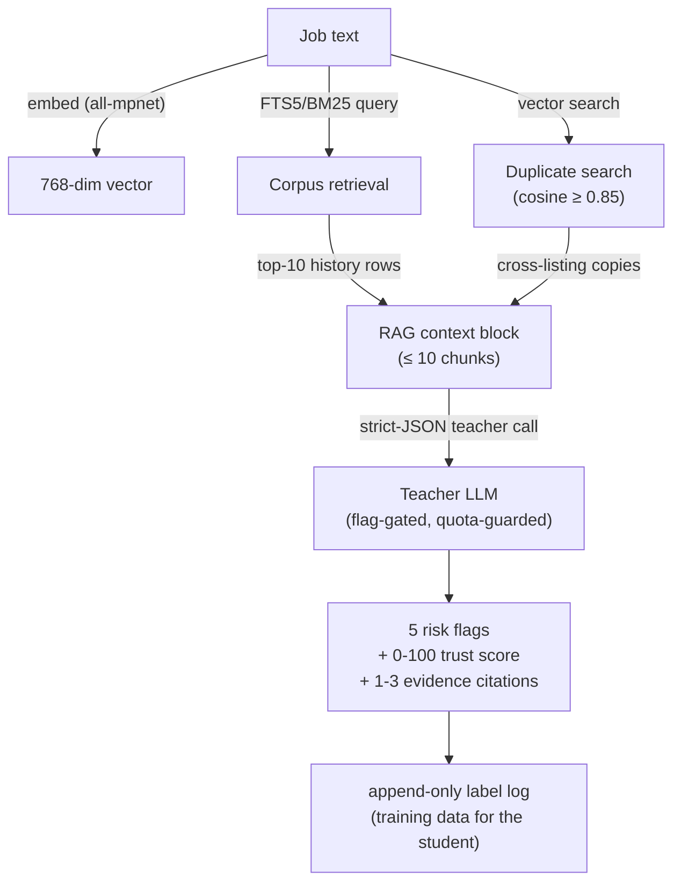

# How the scam / fake-job detection works

Four layers, cheapest first. A listing that looks suspicious gets flagged
early; by the time a job reaches a user's screen it has passed every layer —
and each layer's verdict is recorded, not discarded.

## Layer 1 — Screening at collection time ($0)

Every raw posting (~2,000–3,000/day) is scored by deterministic rules before
it touches storage:

- **Ghost-job heuristics** — reposted date patterns, listings that reappear
  after disappearing
- **Spam scoring** — `spam_confidence_score` + flag list per job
- **Resume-harvesting patterns** — "apply via external link", "no interview"
- **Short/empty description** — dropped entirely, not stored

**Why rules first:** they're free, instant, and catch the obvious 80%. The
remaining layers only see survivors.

## Layer 2 — Duplicates as scam evidence ($0)

A reposted listing under a different URL is one of the strongest ghost
signals. The dedup layer computes it cheaply:

```
exact keys (id, URL)          → immediate collapse
content hash (title+company+
  description fingerprint)    → collapse reworded copies
embedding cosine ≥ 0.88       → collapse semantic twins (768-dim)
```

When the same *job* keeps resurfacing across dates or boards, that history
becomes evidence for Layer 3 instead of just a discarded duplicate.

## Layer 3 — The RAG trust scorer (the interesting part)

This is a retrieval-augmented classifier: before any model judges the job,
the system **retrieves what the corpus already knows about it**.



### The retrieval trick: the title-prefix ladder

The corpus is indexed with SQLite **FTS5**, which ANDs every query token.
A full job description as the query matches *nothing* (15 ANDed terms →
0 hits — measured, not guessed). The fix: retry retrieval with progressively
shorter **title prefixes — 4 → 3 → 2 → 1 words** — until the corpus answers.
Cheap, deterministic, and it turned a 0-hit retrieval into useful context.

### The teacher prompt: scope rules that stop false accusations

The teacher sees the job **plus** the retrieved history — which is dangerous,
because similar-but-different jobs in the context can poison the verdict.
The system prompt enforces:

1. Judge **only** the "Job to evaluate" section.
2. Context jobs may be cited **only as duplication evidence** — never as
   character evidence about the job itself.
3. **High salary is not scam evidence** — UK tech legitimately pays 60–120k.
4. **When in doubt, do not flag** — a missed flag is recoverable; a false
   accusation destroys a legitimate listing.

Output is strict JSON (no prose): 5 booleans + integer score + up to 3
evidence citations. Score bands: ≥80 verified · 60–79 caution · 40–59
low-trust · <40 block-scam-risk.

### Why RAG instead of just prompting a big model?

- **Evidence beats vibes** — every flag can cite a retrieved fact
  ("cross-listing duplicate, cosine 0.92, posted 3× in 14 days").
- **The corpus is the memory** — a scam pattern seen last month is
  retrievable today, with zero retraining.
- **Cost** — retrieval is SQLite + a local embedding; the LLM call is one
  structured-output request per job, and only when the flag is on.

## Layer 4 — The verdicts become training data

Every trust score is appended (never rewritten) to a label log with job_id
and timestamp. At ~1,000 accumulated rows, a **student model distills the
teacher** — and it only replaces the teacher if it beats the teacher's
agreement rate on held-out data. Scam detection that improves itself from
its own verdicts is the end state.

## What a user actually sees

Trust signals surface as flags on job cards (`/trust-score` API). The score
is advisory — borderline listings are demoted, never silently deleted, so
every decision stays auditable.
